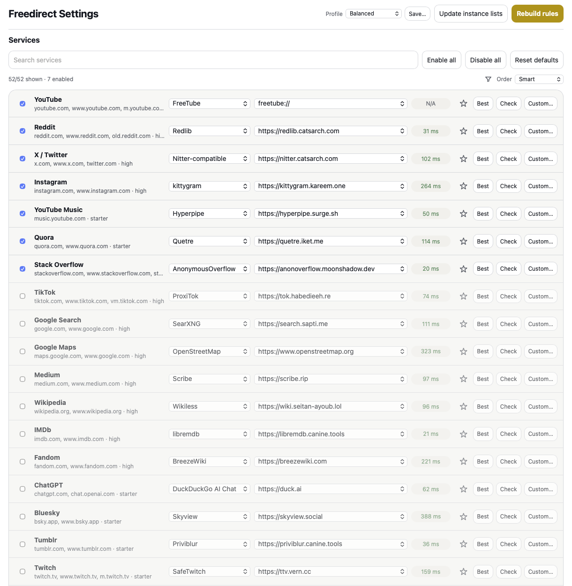

# Freedirect

**Redirige los enlaces de Safari hacia frontends alternativos.**

Freedirect es una Extensión Web de Safari para macOS, iOS y iPadOS. Reescribe los enlaces compatibles antes de que Safari los abra, redirigiendo el navegador desde grandes plataformas hacia frontends alternativos configurados.

Ejemplos:

- YouTube → Invidious, Piped, FreeTube o Materialious
- Reddit → Redlib
- X/Twitter → frontends compatibles con Nitter
- Medium → Scribe o Freedium
- Wikipedia → Wikiless
- IMDb → libremdb
- Fandom → BreezeWiki

La aplicación nativa existe únicamente para contener y habilitar la extensión de Safari. Toda la configuración de redirección se gestiona dentro de la página de ajustes de la extensión.

## Características

- Controles de activación/desactivación por servicio
- Selección de frontend e instancia
- Instancias personalizadas, fijas y rotativas
- Verificaciones de estado de las instancias y selección de la mejor instancia
- Respaldo e importación de JSON
- Reglas de omisión temporal (bypass)
- Depurador de URL y vista previa de reglas generadas
- Redirecciones a las aplicaciones FreeTube y Materialious mediante `freetube://` / `materialious://`
- Fallback de navegación temprana para casos donde el bloqueo de DNS impide que cargue la página original

## Instalación

Las versiones de Homebrew, DMG y App Store estarán disponibles próximamente.

Después de instalar, activa Freedirect en las Extensiones de Safari y establece el acceso al sitio web como "Permitir" para todos los sitios. Las reglas de redirección necesitan acceso a todos los sitios para que Safari pueda ejecutar la extensión antes de que se abran los enlaces compatibles.

## Notas

Freedirect depende de frontends alternativos públicos, y estos pueden ser inestables. Los servicios con frontends públicos inestables pueden estar desactivados por defecto o marcados conservadoramente en la interfaz de ajustes.

Si utilizas FreeTube o Materialious, no bloquees todos los dominios relacionados con YouTube a nivel de DNS. Estas aplicaciones aún necesitan acceso a la API de YouTube y a los dominios de medios para cargar los videos.

## Desarrollo

Las notas de compilación y los detalles de implementación se encuentran en [`TECHNICAL.md`](TECHNICAL.md).

## Créditos

Creado por [0xCUB3](https://github.com/0xCUB3).

Freedirect está inspirado en [LibRedirect](https://github.com/libredirect/browser_extension). Si utilizas Firefox o Chromium, LibRedirect es el proyecto más maduro.

## Licencia

GPL-3.0. Consulta [`LICENSE`](LICENSE).
